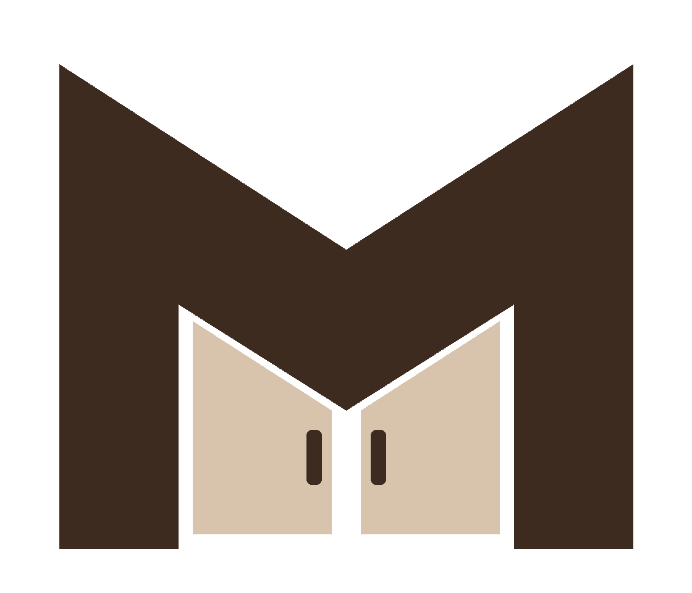

# Mueblería Iván



Plataforma web desacoplada para gestionar el catálogo, las cotizaciones, los pedidos, la producción y los pagos de Mueblería Iván. El repositorio también servirá como prototipo académico de Cloud, DevOps, algoritmos de búsqueda y machine learning.

## Arquitectura

- `frontend/`: React, TypeScript y Vite; despliegue en Netlify.
- `backend/`: Python y FastAPI; despliegue previsto en Render.
- `supabase/`: migraciones, pruebas SQL y datos iniciales de PostgreSQL/Auth.
- `contracts/`: contrato OpenAPI generado por FastAPI.
- `data/`: datasets reproducibles para algoritmos y ML.
- `docs/`: requisitos, seguimiento y coordinación del equipo.
- `scripts/`: verificaciones comunes del repositorio.

El navegador usa Supabase directamente solo para autenticación. Los datos comerciales y las reglas de negocio pasan por FastAPI. Las imágenes se integrarán mediante Cloudinary.

## Inicio rápido

Frontend:

```powershell
cd frontend
npm install
npm run dev
```

Backend:

```powershell
cd backend
python -m venv .venv
.\.venv\Scripts\python.exe -m pip install -e ".[dev]"
Copy-Item .env.example .env
.\.venv\Scripts\python.exe -m uvicorn app.main:app --reload
```

Vite mostrará la URL del frontend, normalmente `http://localhost:5173`. La documentación Swagger estará en `http://127.0.0.1:8000/docs`.

## Verificación

Desde la raíz:

```powershell
.\scripts\verify.ps1
```

También se puede verificar una sola área con `-Scope frontend` o `-Scope backend`.

## Despliegue de demo

Render y Netlify se configuran siguiendo [`docs/DESPLIEGUE_DEMO.md`](docs/DESPLIEGUE_DEMO.md). Render usa el Blueprint `render.yaml`; Netlify toma el build desde `netlify.toml` y requiere variables públicas de API y Supabase configuradas antes de construir.

## Trabajo en equipo

Antes de modificar el proyecto, leer:

1. [`AGENTS.md`](AGENTS.md): instrucciones obligatorias para integrantes y Codex.
2. [`docs/PLAN_MAESTRO.md`](docs/PLAN_MAESTRO.md): alcance y arquitectura.
3. [`docs/PLAN_TRABAJO_PARALELO.md`](docs/PLAN_TRABAJO_PARALELO.md): ramas, propiedad y rutina diaria.
4. [`docs/BASE_DATOS.md`](docs/BASE_DATOS.md): diseño y criterio de finalización de PostgreSQL/Supabase.
5. [`docs/SEGUIMIENTO.md`](docs/SEGUIMIENTO.md): estado y evidencias.
6. [`docs/FRONTEND_ROADMAP.md`](docs/FRONTEND_ROADMAP.md): evolución visual y funcional.

No se trabaja directamente sobre `main`. Cada cambio se desarrolla en una rama `codex/<area>-<tarea>` y se integra mediante una revisión pequeña.

## Estado funcional actual

El frontend React ya consume el catálogo, cotizaciones, pedidos, operaciones del taller, optimizaciones y ML mediante FastAPI; Supabase se utiliza en el navegador para autenticación. El backend implementa PostgreSQL/Supabase, roles, catálogo, cotizaciones, flujo del taller, pagos, algoritmos y modelos consultivos. Las fases 7 y 8 completarán pruebas de experiencia, configuración del hosting y demo pública.

Los resultados ML se etiquetan `Datos de prueba` hasta que exista suficiente historial operativo; las métricas se calculan desde el dataset reproducible y no se escriben a mano.
