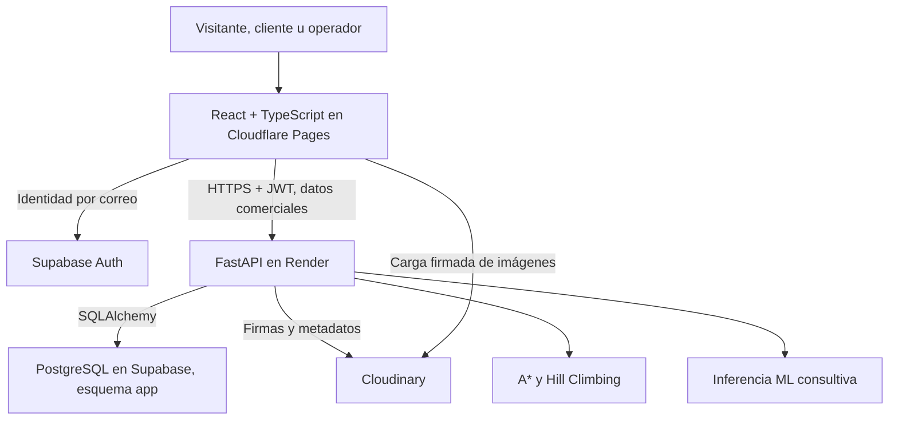

# Evidencia y guion de la demo

Fecha de corte: 2026-11-28. Este documento reúne la arquitectura desplegada, las métricas verificables y el recorrido de exposición. Los resultados de ML provienen de datos de prueba; la demo todavía requiere validar el flujo autenticado completo y realizar sesiones con usuarios.

## Arquitectura desplegada

FastAPI valida JWT, rol y propiedad antes de consultar datos comerciales. El navegador usa Supabase directamente solo para autenticación. PostgreSQL conserva cotizaciones, pedidos, pagos, auditoría, ejecuciones de algoritmos y predicciones. Los importes viajan en céntimos y las medidas canónicas en milímetros. Los modelos y algoritmos recomiendan acciones; no modifican pedidos ni pagos por sí solos. El contrato versionado es [`contracts/openapi.json`](../contracts/openapi.json).

URL pública: <https://muebleria-ivan.pages.dev>. API y Swagger: <https://muebleria-ivan.onrender.com/docs>. Netlify continúa documentado como respaldo durante el cambio de hosting; el retiro definitivo no está registrado como completado en [`SEGUIMIENTO.md`](SEGUIMIENTO.md).

## Métricas y pruebas verificadas

| Evidencia | Resultado | Alcance |
| --- | --- | --- |
| Frontend unitario, 2026-11-28 | 21 pruebas en 10 archivos aprobadas; build aprobado | Ejecución local con `npm run test` y `npm run build` |
| Playwright local, 2026-11-28 | 3 casos aprobados | Cotización, aprobación administrativa, teclado, Axe y responsive; API simulada |
| Playwright contra Cloudflare, 2026-11-28 | 3 casos aprobados | Catálogo, detalle, estimación real y protección del portal sin sesión; sin escrituras |
| PostgreSQL/Supabase, 2026-11-21 | 68 comprobaciones pgTAP aprobadas | Base publicada; consulta la evidencia en [`SEGUIMIENTO.md`](SEGUIMIENTO.md) |
| API publicada, 2026-11-28 | 36 solicitudes, 0 errores HTTP | 12 solicitudes secuenciales por ruta; muestra exploratoria |

En la muestra pública, el P95 fue **1452,9 ms** para la lista de 100 productos, **680,3 ms** para un detalle y **912,6 ms** para estimación. Incluye red, Render y PostgreSQL; no es una prueba de carga ni de concurrencia. El detalle quedó por debajo de 700 ms en esta muestra pequeña, mientras la lista superó ese objetivo de referencia. El método y los P50 están en [`frontend/quality/PERFORMANCE_BASELINE.md`](../frontend/quality/PERFORMANCE_BASELINE.md).

El dataset sintético contiene **500 pedidos** con semilla 2026 y separación **350/75/75** para entrenamiento, validación y prueba. En el conjunto de prueba, la regresión activa obtuvo MAE **0,9227 días** y R² **0,89811**; la clasificación activa obtuvo F1 **0,57143** y ROC-AUC **0,70069**. Son métricas calculadas por el pipeline y registradas en [`backend/artifacts/ml/manifest.json`](../backend/artifacts/ml/manifest.json), etiquetadas **Datos de prueba**. No demuestran precisión comercial con pedidos reales. La latencia de inferencia y las pruebas con 5–8 usuarios siguen pendientes.

## Guion de demostración

1. Abrir la [web pública](https://muebleria-ivan.pages.dev), entrar al catálogo y mostrar un producto con imagen y precio de referencia.
2. Abrir el cotizador, cambiar medidas o material y explicar que FastAPI calcula la estimación. Enviar una cotización con contacto ficticio solo durante el smoke test integral autorizado.
3. Iniciar sesión con una cuenta administrativa de demo; localizar la cotización, aprobarla y convertirla en pedido con dirección de prueba.
4. Registrar el anticipo ficticio, avanzar producción, mostrar el historial y completar el saldo antes de instalar.
5. Mostrar Hill Climbing y A* en administración. Comparar la solución inicial y la sugerencia, dejando claro que no aplican cambios automáticamente.
6. Mostrar modelos, predicción y métricas etiquetadas **Datos de prueba**. Explicar la línea base y el fallback si falta un artefacto.
7. Abrir [Swagger](https://muebleria-ivan.onrender.com/docs), el [seguimiento](SEGUIMIENTO.md) y el pipeline de CI para señalar contrato, pruebas y despliegue.
8. Cerrar con límites observados: falta validar el recorrido autenticado en la demo pública, medir inferencia y completar las sesiones de usuarios, SUS y tiempos.

Las contraseñas de las cuentas demo se gestionan fuera del repositorio. Antes de presentar, ejecutar el recorrido completo con datos ficticios y guardar capturas o video de respaldo sin datos personales. El protocolo de participantes está en [`PROTOCOLO_PRUEBA_USUARIO.md`](PROTOCOLO_PRUEBA_USUARIO.md).
