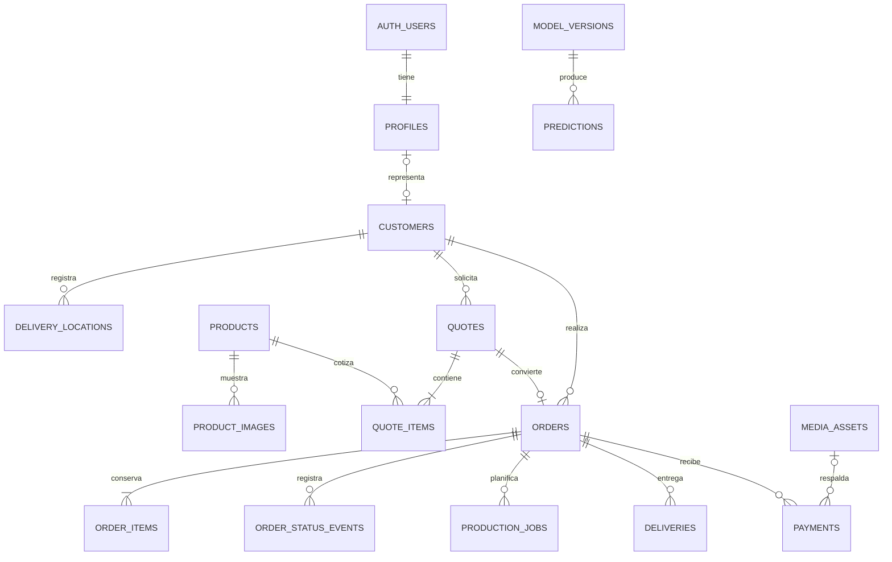

# Esquema de datos

Todos los importes se almacenan como `bigint` en céntimos, las medidas como
enteros en milímetros y los instantes como `timestamptz` en UTC.

## Diccionario resumido

| Tabla | Propósito | Propiedad o acceso principal |
| --- | --- | --- |
| `profiles` | Perfil mínimo vinculado a `auth.users` | Usuario propio; administrador |
| `customers` | Cliente con o sin cuenta | Perfil vinculado; personal |
| `delivery_locations` | Direcciones y coordenadas | Cliente propietario; personal |
| `products` | Catálogo y rangos permitidos | Lectura activa; administrador |
| `product_images` | Metadatos Cloudinary ordenados | Lectura activa; administrador |
| `materials`, `finishes`, `accessories` | Opciones y ajustes de precio | Lectura disponible; administrador |
| `product_*` | Disponibilidad por producto | Lectura activa; administrador |
| `pricing_rules` | Reglas versionadas de cálculo | Administrador |
| `quotes`, `quote_items` | Solicitud y snapshot cotizado | Propietario; personal |
| `orders`, `order_items` | Pedido y snapshot aprobado | Cliente; personal |
| `order_status_events` | Línea de tiempo append-only | Cliente; personal |
| `production_jobs` | Planificación y horas | Cliente en lectura; personal |
| `deliveries` | Ventana y secuencia de entrega | Cliente en lectura; personal |
| `media_assets` | Referencias públicas o privadas | Propietario; personal |
| `payments` | Registro idempotente y reversión | Cliente en lectura; personal |
| `customer_events` | Eventos autorizados mínimos | Operador y administrador |
| `model_versions`, `predictions` | Versiones y resultados de ML | Operador y administrador |
| `optimization_runs` | Ejecuciones consultivas | Operador y administrador |
| `audit_logs` | Cambios sensibles append-only | Administrador |

La definición exhaustiva de columnas, checks, índices y políticas está en la
migración base. Los modelos SQLAlchemy deben reflejar esa definición.
